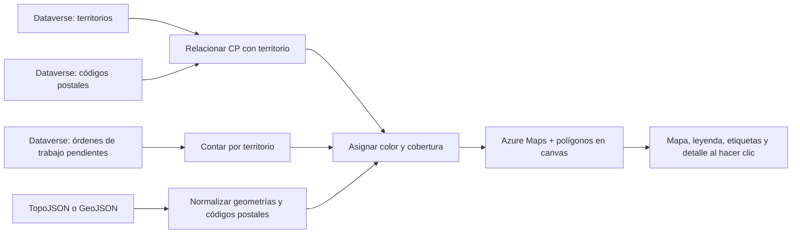

# Territorios Field Service

Control PCF estándar para **Power Apps / Dynamics 365** que representa sobre un mapa los códigos postales y los territorios de Microsoft Dataverse. Está pensado para ayudar a visualizar la cobertura territorial y el volumen de órdenes de trabajo pendientes, con cartografía de códigos postales suministrada como TopoJSON o GeoJSON.

El control combina:

- **Azure Maps** para el mapa base y los estilos cartográficos.
- **Dataverse** para consultar territorios, códigos postales asignados y órdenes de trabajo.
- **TopoJSON o GeoJSON** para los límites geográficos de los códigos postales.
- Un `canvas` superpuesto para dibujar los polígonos, etiquetas y resaltados.

> El mapa es una herramienta de consulta y visualización. El control no crea ni modifica territorios, códigos postales u órdenes de trabajo en Dataverse.

## Vista funcional



La geometría cartográfica y los datos de Dataverse tienen funciones distintas: el archivo geográfico aporta la forma y la posición de cada código postal; Dataverse aporta la asignación del código postal a un territorio y el recuento de órdenes de trabajo. Para colorear un polígono se coteja su código postal con el nombre del registro de código postal en Dataverse.

## Qué ofrece

### Mapa de territorios y códigos postales

- Presenta el mapa inicialmente centrado en España.
- Dibuja las geometrías de los códigos postales sobre el mapa base.
- Usa colores diferenciados para los territorios. El control cuenta con una paleta de 20 colores; si hay más territorios que colores, la paleta vuelve a empezar.
- Muestra en gris claro los polígonos que no están asignados a un territorio visible.
- Mantiene las geometrías alineadas con el mapa cuando se mueve, cambia el zoom o cambia el tamaño del control.
- Permite elegir entre los estilos **Calles**, **Oscuro** y **Satélite**. En el estilo satélite se superpone una capa híbrida de carreteras y nombres.
- Incluye controles propios para acercar y alejar.
- Permite hacer clic en un código postal para resaltarlo y abrir una ficha con su código postal, el territorio asignado, las órdenes pendientes de ese territorio y el número de códigos postales asignados.

### Leyenda de territorios

La barra lateral muestra una fila por territorio con:

- Su color y nombre.
- El número de códigos postales asignados según los polígonos cargados.
- El número de órdenes de trabajo pendientes consultado en Dataverse.

Al seleccionar un territorio de la leyenda, el mapa ajusta el encuadre a su extensión geográfica calculada a partir de los códigos postales asignados.

### Opciones de visualización

- **Bordes CPs** alterna la visualización de los límites internos entre códigos postales. Con los bordes ocultos, los trazos usan el color del territorio para que las uniones resulten menos prominentes.
- **Etiquetas** recorre tres modos: número compacto de órdenes pendientes, etiqueta completa con nombre y número de órdenes, y etiquetas ocultas.
- **Sincronizar Dataverse** vuelve a consultar los datos del entorno seleccionado e intenta representar el resultado.
- El indicador de estado informa del entorno activo, el avance de carga y el resultado o los errores de las operaciones.

### Cartografía local, remota y modo de demostración

- **Cargar TopoJSON** permite seleccionar un archivo local con extensión `.json`, `.topojson`, `.geojson` o `.js`. El contenido debe ser JSON válido en formato TopoJSON o GeoJSON; el control no ejecuta archivos JavaScript.
- La propiedad `topoJsonUrl` permite cargar la cartografía desde una URL, por ejemplo una ruta de recurso web de Dataverse.
- **Simular (Test)** asigna los códigos postales a seis territorios de demostración usando los dos primeros dígitos del código postal. Los nombres y los recuentos de órdenes son valores fijos de prueba y no representan datos reales.

> **Importante sobre la demostración:** si hay cartografía cargada pero Dataverse no devuelve asignaciones de códigos postales, el control puede aplicar automáticamente los territorios de prueba. También los aplica como alternativa si falla la consulta y todavía no hay asignaciones disponibles. Comprueba el estado, los nombres de territorios y la fuente de datos antes de interpretar los resultados como información productiva.

## Datos consultados

En el modo normal, el control realiza consultas de solo lectura:

| Información | Tabla lógica | Datos utilizados | Criterio funcional |
|---|---|---|---|
| Territorios | `territory` | `territoryid`, `name` | Carga el catálogo y asigna colores de presentación. |
| Códigos postales | `msdyn_postalcode` | `msdyn_postalcodeid`, `msdyn_name`, territorio relacionado, `statecode` | Considera registros activos (`statecode = 0`) que tienen un territorio relacionado. |
| Órdenes de trabajo | `msdyn_workorder` | Identificador de orden, territorio, estado del sistema y `statecode` | Cuenta por territorio las órdenes activas (`statecode = 0`) cuyo `msdyn_systemstatus` es `690970000`. |

La consulta de códigos postales solicita páginas de hasta 5.000 registros y procesa como máximo 10 páginas en una ejecución. Por tanto, la carga de esta tabla está limitada a un máximo de 50.000 registros por sincronización.

El código postal se obtiene de las propiedades de la geometría, buscando primero nombres habituales como `COD_POSTAL`, `cod_postal`, `CP`, `cp`, `postalcode`, `codigo_postal` o `msdyn_name`; si no se encuentra, también puede utilizar el identificador de la entidad geográfica. Los códigos se normalizan para facilitar la coincidencia, conservando el primer grupo numérico y completándolo con ceros a la izquierda hasta cinco caracteres.

Las etiquetas y los totales de órdenes se calculan por **territorio**, no por código postal individual. Un polígono sin correspondencia se dibuja como no asignado.

## Requisitos y configuración

### Requisitos

- Una solución o aplicación Power Platform donde se pueda instalar y alojar un control PCF.
- Una cuenta de Azure Maps y su clave de suscripción.
- Permisos de lectura en Dataverse para las tablas de territorios, códigos postales y órdenes de trabajo necesarias.
- Un archivo o recurso accesible de cartografía TopoJSON o GeoJSON cuyos polígonos correspondan a códigos postales.
- Acceso a los servicios de Azure Maps desde el cliente. El control utiliza el dominio europeo `eu.atlas.microsoft.com`.

El manifiesto habilita el uso de Web API y declara como dominios externos `atlas.microsoft.com`, `eu.atlas.microsoft.com` y `*.dynamics.com`.

### Propiedades del control

| Propiedad | Tipo / uso | Requerida | Descripción |
|---|---|---:|---|
| `value` | Texto enlazado (`bound`) | No | Campo del formulario donde se aloja el control. El control no publica un valor funcional en dicho campo. |
| `azureMapsKey` | Texto de entrada (`input`) | Sí | Clave de suscripción de Azure Maps. |
| `topoJsonUrl` | Texto de entrada (`input`) | No | URL de un archivo TopoJSON o GeoJSON. Puede ser una ruta relativa, como `/WebResources/sec_codigos_postales_es.js`, o una URL accesible desde el navegador. |
| `targetEnvironmentUrl` | Texto de entrada (`input`) | No | URL base de un entorno Dataverse externo. Si se deja vacío, se usa la Web API del entorno actual. |
| `targetAccessToken` | Texto de entrada (`input`) | No | Token OAuth para autenticar la consulta al entorno externo, si es necesario. |

Configura `azureMapsKey` en las propiedades del componente. Si configuras `topoJsonUrl`, el control intenta cargar esa cartografía al inicializarse; también puedes cargar un archivo manualmente desde la interfaz.

### Datos de cartografía

El control acepta:

- Un objeto **TopoJSON** de tipo `Topology` que contenga al menos una capa en `objects`. Se convierte la primera capa encontrada.
- Un objeto **GeoJSON** de tipo `FeatureCollection`.
- Geometrías `Polygon` y `MultiPolygon`.

Cada entidad geográfica debe contener un código postal en alguna de las propiedades reconocidas (o en `feature.id`). Los polígonos se interpretan con coordenadas geográficas de longitud y latitud, en ese orden.

El archivo debe estar disponible para el navegador que ejecuta el formulario. Si se aloja como recurso web de Dataverse, configura la ruta apropiada en `topoJsonUrl`; si se carga desde otra ubicación, asegúrate de que la URL sea accesible y permita la solicitud desde el origen de la aplicación.

## Entorno actual y entorno externo

De forma predeterminada, las consultas se hacen con `context.webAPI.retrieveMultipleRecords` en el entorno de Dataverse donde se está ejecutando el control.

Para consultar otro entorno:

1. Pulsa **Entorno Externo**.
2. Escribe la URL base del entorno, por ejemplo `https://org-test.crm4.dynamics.com`.
3. Si el entorno requiere autenticación explícita, introduce un token OAuth.
4. Pulsa **Aplicar y Consultar**.

El control normaliza la URL y, si el token se proporciona sin el prefijo `Bearer`, lo añade para la solicitud. Si se configura un token, la petición externa utiliza autenticación Bearer y omite las credenciales del navegador; si no, utiliza las credenciales incluidas del navegador. **Usar Entorno Actual** borra la configuración manual de URL y token y vuelve a consultar el entorno actual.

### Consideraciones de seguridad

- Trata la clave de Azure Maps y los tokens OAuth como credenciales: no los incluyas en repositorios, capturas de pantalla ni documentación compartida.
- Un token introducido en la interfaz se usa desde el cliente del usuario; no debe considerarse un mecanismo de almacenamiento secreto ni un sustituto de los controles de acceso de Dataverse.
- Limita el acceso del usuario y la validez del token a lo estrictamente necesario. Para escenarios productivos entre entornos, valida la estrategia de autenticación y el uso de credenciales con el equipo responsable de Power Platform.
- La URL externa debe ser confiable y accesible desde el navegador; el entorno y sus políticas deben permitir la solicitud.

## Uso habitual

1. Configura la clave de Azure Maps en el componente.
2. Proporciona una cartografía compatible mediante `topoJsonUrl` o el botón **Cargar TopoJSON**.
3. Espera a que el mapa termine de cargar y consulta el mensaje de estado.
4. Pulsa **Sincronizar Dataverse** para cargar los datos del entorno actual, o selecciona primero el entorno externo.
5. Explora la cobertura con los estilos del mapa, el zoom y la leyenda.
6. Haz clic en un polígono para consultar su código postal y la información agregada de su territorio.
7. Usa los controles de bordes y etiquetas según el nivel de detalle que necesites.

## Estructura del proyecto

```text
TerritoriosPCF/
├── Territorios/
│   ├── ControlManifest.Input.xml  # Propiedades y recursos del PCF
│   ├── index.ts                   # Interfaz, consultas, lógica y renderizado
│   └── css/
│       └── Territorios.css        # Presentación del control
├── package.json                   # Dependencias y comandos npm
├── pcfconfig.json                 # Configuración de salida del control
└── TerritoriosPCF.pcfproj         # Proyecto PCF
```

## Compilar y ejecutar

Instala las dependencias con el gestor de paquetes del proyecto y ejecuta el script de compilación:

```bash
npm install
npm run build
```

Comandos disponibles definidos en `package.json`:

| Comando | Uso |
|---|---|
| `npm run build` | Valida, ejecuta ESLint y compila el control PCF. |
| `npm run lint` | Ejecuta las comprobaciones de ESLint. |
| `npm run lint:fix` | Solicita a ESLint corregir los problemas que pueda arreglar automáticamente. |
| `npm run clean` | Limpia los artefactos generados por las herramientas PCF. |
| `npm run start` | Inicia la experiencia de desarrollo PCF configurada por `pcf-scripts`. |
| `npm run start:watch` | Inicia la experiencia de desarrollo en modo de observación. |

La salida del control se configura en `pcfconfig.json` bajo `out/controls`. La compilación local valida y genera el control; su empaquetado e importación en un entorno requieren el proceso de soluciones de Power Platform utilizado por el equipo.

## Notas funcionales y límites conocidos

- El control no escribe datos en Dataverse y `getOutputs()` no devuelve un valor funcional al campo enlazado.
- Las órdenes pendientes se muestran en el nivel de territorio y usan el valor de estado del sistema `690970000` tal como está definido en la consulta.
- La distribución de colores depende del orden de los registros devueltos para los territorios; los colores son visuales y no constituyen un identificador persistente.
- El centro usado para colocar la etiqueta de un territorio se calcula a partir de las cajas envolventes de los polígonos asignados; no es necesariamente el centroide geométrico exacto.
- La cartografía solo puede representar los territorios que logre asociar mediante coincidencia de códigos postales. Revisa que los códigos de la geometría y los nombres de los registros de Dataverse correspondan.
- La simulación está destinada a pruebas visuales y no debe utilizarse para análisis operativo.

